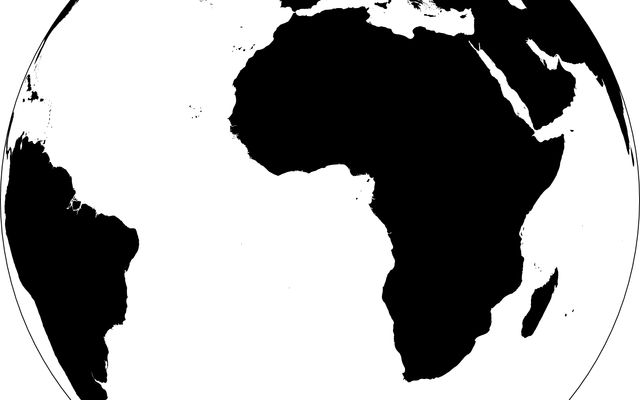
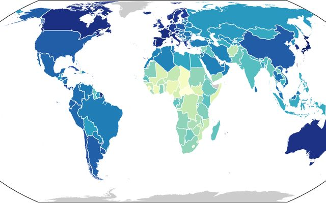
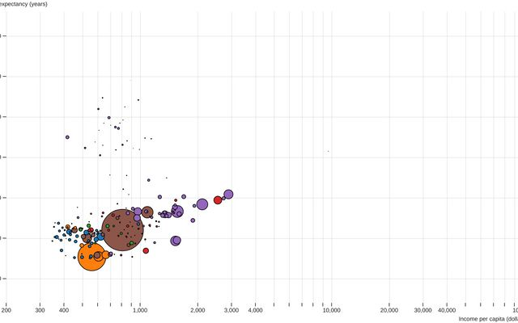
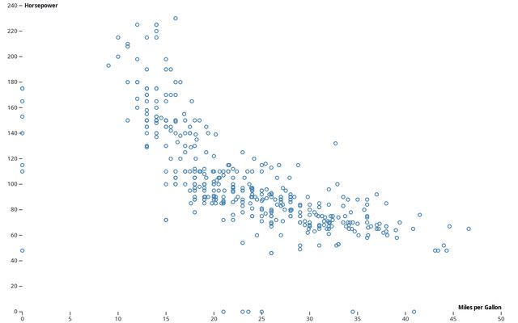
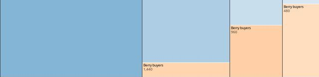
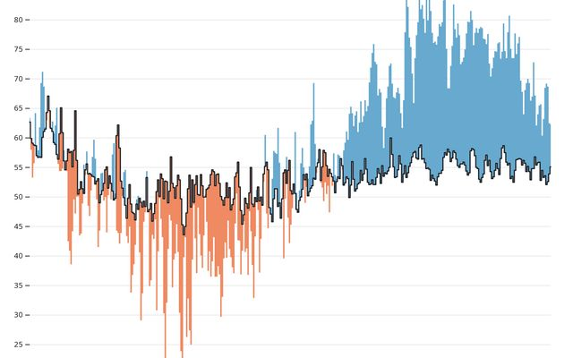
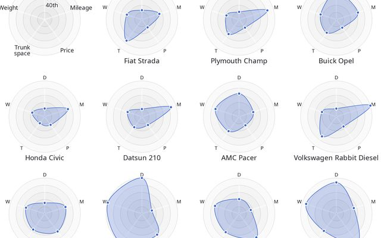
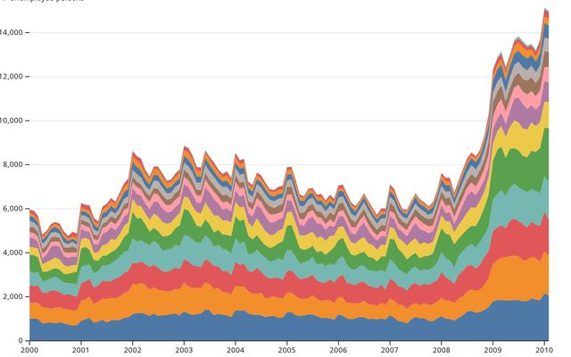
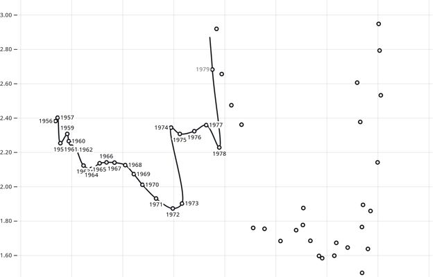

# 1st Iteration — Visualisation Technique Choices

> Covers: "Justified choice of the visualisation techniques selected (for representation,
> presentation, and interaction)."

The application has five linked views. They share the selected **year**, **year range**,
**metric** and **country**. When no country is selected, Views 3 and 4 show the World.

The design follows Shneiderman's mantra: *overview first, zoom and filter, then details on
demand*.

| Mantra step | Where it happens |
|---|---|
| Overview | View 1 (globe), opened on 2024 with the renewable share of electricity |
| Zoom / filter | Year slider and play button, year range, metric selector (one year, range average or change between two years), brushing in View 2, legend filtering in View 3 |
| Details on demand | Tooltips, and Views 3 and 4 for the selected country |
| Relate | View 5 compares country profiles side by side; brushing in View 2 highlights on the globe |
| History | Play button replays the years; the Range average and Change modes summarise a period on the map; Views 3 and 4 show a country's whole path |

Each view shows a different slice of the same data (country × year × variable), so the views
do not repeat each other even when they reuse a variable:

| View | Countries | Years | Variables | Question |
|---|---|---|---|---|
| 1 Map | all, in geographic space | 1, or a range summarised as an average or a change | 1 metric | *Where, and since when?* |
| 2 Bubble scatter | all | 1 | 3 emissions measures | *Who pollutes the most, by which measure?* |
| 3 Marimekko | 1 | all | 9 sources + total | *What is the electricity made of?* |
| 4 Race + decomposition | 1 (or World) | selected range | generation, low-carbon generation, emissions | *Is green growth keeping up with demand, and why?* |
| 5 Country profiles | a few, chosen by the user | 1 | 6 indicators | *How do these countries compare?* |

## View 1 - Rotating globe

| Globe (orthographic, drag to rotate) | Flat map (choropleth) |
|---|---|
|  |  |
| [*Versor dragging*](https://observablehq.com/@d3/versor-dragging) | [*World choropleth*](https://observablehq.com/@d3/world-choropleth) |

- **Question(s) answered:** Where and when has electricity become greener? Which countries go
  against the trend?
- **Representation:** orthographic globe coloured as a choropleth by the selected metric:
  renewable share (default), fossil share or carbon intensity. Each country gets one colour,
  computed in one of three modes:
  - **Year:** the value in the selected year.
  - **Range average:** the average of the metric over **all years or a range of years**
    (e.g. 2000–2024), on the same sequential scale as the Year mode.
  - **Change:** the difference in the metric between the first and last year of the range
    (e.g. renewable share in percentage points, 2000 → 2024), on a diverging scale centred on
    zero.

  Countries without data are grey. In Range average mode a country needs data in at least half
  of the years of the range; in Change mode it needs data in both years.
- **Presentation:** largest view on the screen, with a colour legend, a year slider with a play
  button, and a coverage indicator ("Data available: 196 / 214 countries"). Colour scales are
  fixed across years, so a colour change always means a change in the data. In the Range
  average and Change modes the slider gets a second handle for the start of the range
  (default 2000); the range also sets the start year of View 4. The diverging scale uses the
  same direction for every metric: green means greener or cleaner, red means the opposite.
  In Range average mode the tooltip says how many years of the range have data.
- **Interaction:** drag to rotate; slider and play to change the year; hover for a tooltip;
  click to select a country (the globe rotates to it); search box for small countries; a
  **Globe / Flat map** toggle switches to a world map (Equal Earth projection) with an animated
  transition. The selected year, range, metric and country are kept when switching. A
  **Year / Range average / Change** toggle switches between the three modes.
- **Why this technique:** a map is the natural overview of per-country data, and a globe is
  more engaging than the flat map OWID already provides. Only half the world is visible at
  once, which rotation and the search box compensate for. Users who find the globe hard to use,
  or who want to see every country at once, can switch to the flat map. Equal Earth keeps
  country areas proportional, so large high-latitude countries (Russia, Canada) are not
  exaggerated as they would be with Mercator. One year can be misleading: a dry year lowers
  hydro output, so a country's renewable share can drop for one year only. The Range average
  mode summarises a whole period in one colour and smooths out these single years. The Change
  mode is needed to *find* the countries that go against the trend: the other views show one
  year, or one country at a time, so without it a user would have to inspect each country in
  View 4. In Change mode these countries stand out as red areas on an otherwise green map,
  and a click opens View 4 to confirm the country's path.

## View 2 - Emissions bubble scatter

| Bubble scatter (log x, area, animated by year) | Brushing |
|---|---|
|  |  |
| [*The Wealth & Health of Nations*](https://observablehq.com/@mbostock/the-wealth-health-of-nations) | [*Brushable scatterplot*](https://observablehq.com/@d3/brushable-scatterplot) |

- **Question(s) answered:** Who pollutes the most, and by which measure?
- **Representation:** one bubble per country for the selected year. x = emissions per capita
  (log scale), y = carbon intensity, area = total emissions, colour = same metric as the globe.
- **Presentation:** axes with units, labels only for the largest emitters and the selected
  country, dashed lines at the World's values. A notice is shown for years before 2000, when
  there is no emissions data.
- **Interaction:** hover for a tooltip; click to select a country; brush to select a group,
  which is highlighted on the globe; bubbles move smoothly when the year changes.
- **Why this technique:** a bar chart ranks countries by one measure only. The scatter shows
  three measures at once, so it reveals that the rankings disagree (e.g. China emits the most
  in total, but not per person).

## View 3 - Electricity mix over time (temporal Marimekko)

*Base example: [Marimekko chart](https://observablehq.com/@d3/marimekko-chart), used here
over time instead of for a single moment.*

- **Question(s) answered:** What is a country's electricity made of, and how has it changed?
  How much has its total generation grown?
- **Representation:** one column per year (1985–2025). The **width** of each column is the
  country's total generation that year (TWh), and the column is split into segments whose
  **height** is each source's share of generation (%). Fossil sources sit at the bottom in warm
  colours (coal, oil, gas), then nuclear, then renewables on top in cool/green colours. The
  **area** of each segment is therefore the TWh generated by that source in that year.
- **Presentation:** the selected year's column is outlined. Year labels sit under the columns
  (only every 5 years if the columns are narrow), because the x axis is not linear in time:
  wider columns mean more generation, not more years. A dashed line at 50% marks where the
  low-carbon share passes half of generation.
- **Interaction:** hover a segment for its source, TWh and %; click a column to set the year;
  click a legend item to highlight that source (the other segments fade).
- **Why this technique:** the stacked area chart we first chose (see *Alternatives
  considered*) needed a TWh / % toggle, because it shows either the totals or the shares. The
  Marimekko shows both at once: the shares in the heights and the growth of demand in the
  widths. Columns that get wider while the green part grows only slowly show the "greener,
  but not cleaner" pattern that View 4 then explains. Widths are read less precisely than
  heights, so the usability tests will check whether users notice that wider columns mean
  more electricity. If they do not, the stacked area chart is the fallback.

## View 4 - Is green growth keeping up? (difference chart + decomposition)

*Base example: [Difference chart](https://observablehq.com/@d3/difference-chart). The
decomposition panel below it is our own design.*

- **Question(s) answered:** Is green growth keeping up with demand? Why do emissions rise or
  fall? Does a country found in View 1 really go against the trend?
- **Representation:** two panels that share the same time axis, from the start of the year
  range (default 2000) to its end.
  1. **The race (difference chart).** Two lines, both counted from the start year:
     *new demand* = growth in total generation (TWh), and *new low-carbon generation* = growth
     in nuclear + renewable generation (TWh). The area between them is **green** where clean
     generation grew more than demand, and **red** where it did not. The gap between the lines
     is exactly the change in fossil generation, so a red area means fossil generation grew.
  2. **Why emissions changed (decomposition).** Emissions are generation × carbon intensity
     (checked in the data: `greenhouse_gas_emissions` = `electricity_generation` ×
     `carbon_intensity_elec`, to rounding, in all 6,002 rows that have the three values). The change in emissions since the start year is
     split into a **demand effect** (more electricity → more emissions, a bar above zero) and a
     **mix effect** (cleaner electricity → fewer emissions, a bar below zero), with a line for
     the actual net change. The split uses the logarithmic mean Divisia index (LMDI), so the two
     effects add up exactly to the net change. For the World, 2000 → 2024: demand +7.8 Gt, mix
     −1.2 Gt, net +6.5 GtCO₂e.
- **Presentation:** values in TWh (race) and MtCO₂e (decomposition), with the selected year
  marked by a vertical line across both panels. A switch shows values relative to the start
  year (% of start-year generation and emissions), so that the selected country can be drawn
  over the World's curve in grey. A notice replaces the decomposition for years before 2000,
  when there is no emissions data.
- **Interaction:** hover for the values of a year in both panels; click to set the year; the
  start year comes from the range slider; switch between absolute and relative values.
- **Why this technique:** the question is literally whether one quantity keeps up with
  another, and a difference chart shows that as a coloured gap that needs no explanation. The
  World's chart is almost entirely red from 2000 to 2024: low-carbon generation grew by
  7,300 TWh, but demand grew by 15,700 TWh, so fossil generation still grew by 8,400 TWh.
  The race shows *that* emissions rose; the decomposition shows *why*, separating the effect
  of more demand from the effect of a cleaner mix. This is the "greener, but not cleaner"
  question in one view. The connected scatterplot we first chose (see *Alternatives
  considered*) showed the relation between renewable share and emissions, but was harder to
  read (Haroz et al., 2016) and did not explain the cause.

## View 5 - Country profiles (radar small multiples)

*Base example: [Plot: Radar chart, small multiples](https://observablehq.com/@observablehq/plot-radar-chart-faceted).*

- **Question(s) answered:** How does a country compare with others across several measures
  at once? (e.g. Inês comparing Portugal with other European countries.) Which countries are
  clean for different reasons (nuclear vs. renewables)?
- **Representation:** one radar ("star glyph") per country for the selected year, with six
  axes: renewable share, nuclear share, generation per capita, generation growth since the
  start year, emissions per capita, carbon intensity. The clean indicators sit in the upper
  half and the polluting ones in the lower half, so a top-heavy shape reads as clean. Shares
  use a fixed 0–100% scale; the other axes go from 0 to the 95th percentile of all countries,
  and values above it are clipped and marked.
- **Presentation:** small multiples: the World first as a reference, then the selected
  country, then up to five more countries chosen by the user. The World's shape is drawn in grey
  behind every country's shape. Axis labels on the first radar only; light fill.
- **Interaction:** hover a vertex for the exact value and unit; click a radar to select that
  country; add a country with "+ Compare" (in the tooltip of Views 1 and 2) and remove it with
  ×; the radars change with the year.
- **Why this technique:** a radar is a glyph that shows many variables of one country as one
  shape, and small multiples make shapes easy to compare. It answers a question no other
  view answers: comparing a handful of chosen countries on every measure at once. France
  (nuclear) and Denmark (wind) both have low carbon intensity, but their shapes differ. Radars
  have known problems: the area grows with the square of the values and depends on the order of
  the axes. We keep the axis order fixed, use few axes and a light fill, and give exact values
  on hover.
- **Library note:** the base example uses Observable Plot, not D3. We plan to build the view in
  D3 following the example's design. If we use Plot itself, we will first discuss it with
  the lab teachers, as the assignment requires, and reference it.

## Cross-view interaction

- **Year** (slider, play, or click in Views 3/4) updates every view.
- **Year range** (second slider handle) sets the Range average and Change modes of the map
  and the start year of View 4.
- **Country** (click on the map, a bubble or a radar, or search) is highlighted
  in Views 1, 2 and 5 and shown in Views 3 and 4.
- **Brushing** in View 2 highlights the selected countries on the globe.
- **Hovering** a country in View 1 or 2 highlights it in the other.

This linking between views was inspired by InsightChaser (Liu et al., 2026); see
*Related work and inspiration*.

## Alternatives considered

| Technique | Was used for | Why it was replaced |
|---|---|---|
|  Stacked area chart | View 3 | Needs a TWh / % toggle to show totals and shares; the middle layers (nuclear, hydro) have no flat baseline and are hard to read. Kept as the fallback if the Marimekko fails in the tests. |
|  Connected scatterplot (renewable share × emissions) | View 4 | Harder to read (Haroz et al., 2016), and shows that emissions and renewables move together but not why. Replaced by the race + decomposition. |

## Related work and inspiration

The views were designed after looking at existing visualisations of the same kind of data. No
code was reused from them. If any is reused in the d3.js build, it will be referenced in the
code and in the README.

### Our World in Data — Energy (https://ourworldindata.org/energy)

The source of our dataset. Its charts and explorers gave us:

- **The metrics:** share of generation by source, per-capita values and carbon intensity,
  rather than absolute totals only.
- **The electricity mix by source over time** (*Share of electricity production by source*,
  a stacked area chart). It was our first choice for View 3, which now uses a temporal
  Marimekko to show totals and shares at once.
- **The map + time slider pattern** and the **multi-country selection** of its explorers.

What we do differently: OWID shows each chart on its own, and the user switches between them
(line, bar, map tabs). Our five views are linked, sharing the year, range, metric and selected
country. We add a globe, range-average and change modes on the map, and
a view that separates the effect of demand from the effect of a cleaner mix (View 4).

### Project — World Energy Trends (https://observablehq.com/@emile-f/project-world-energy-trends)

A student project on Observable, built with D3 on BP *Statistical Review* data. Its
*Map of Energy Consumption in 2020 from Oil* is close to our View 1: a choropleth of one
energy variable per country, in the Equal Earth projection, with a tooltip.

| World Energy Trends | Our application |
|---|---|
| Energy **consumption** | Electricity **generation** and its link with carbon emissions |
| Absolute values (e.g. oil consumption), which mostly reflect country size | Shares, carbon intensity and per-capita values, comparable between countries |
| Flat map only | Globe, plus a flat map with an animated transition |
| One year at a time | Year slider with play, and **range average** and **change** modes over a range of years |
| Each chart on its own | Linked views (selection, brushing, shared year and range) |

We also use Equal Earth for the flat map, for the reason given in View 1 (country areas are
kept proportional).

### InsightChaser (Liu et al., 2026)

Z. Liu, W. Zhao, X. Xie, A. Cao, Y. Wu, H. Zhang and Y. Wu, "InsightChaser: Enhancing Visual
Reasoning of Sports Tactical Visualization with Visual-Text Linking", *IEEE Transactions on
Visualization and Computer Graphics*, vol. 32, no. 1, 2026. DOI: 10.1109/TVCG.2025.3634639.

A paper studied in the course. Its system links a text insight to the matching elements of
several views: selecting an entity highlights it in the visualisation and in the context view.
It also uses visual effects (highlight, add, cover) to guide the reader. **Our cross-view
linking is inspired by it.** Selecting a country, a year or a group of countries in one view
highlights the same items in the others, so the user can follow one entity across different
representations. The difference is that InsightChaser links text to visualisations, using a
knowledge graph and an LLM. Our application links visualisations to each other, through the
shared year, range, metric and country, with no text or LLM involved.

### D3 gallery (https://observablehq.com/@d3/gallery) and Observable examples

Examples used as a reference for the techniques. The images shown under each view are the
Observable thumbnails of these examples (stored in `img/examples/`), reproduced only to
illustrate the technique; they are not our data.

- *World choropleth*, *Versor dragging*, *Orthographic to equirectangular* → View 1 (globe
  rotation and the globe / flat map transition)
- *The Wealth & Health of Nations* (Bostock), *Brushable scatterplot* → View 2
- *Marimekko chart* → View 3
- *Difference chart* → View 4
- *Plot: Radar chart, small multiples* (Observable Plot) → View 5
- *Stacked area chart*, *Connected scatterplot* → first choices for Views 3 and 4 (see
  *Alternatives considered*)
