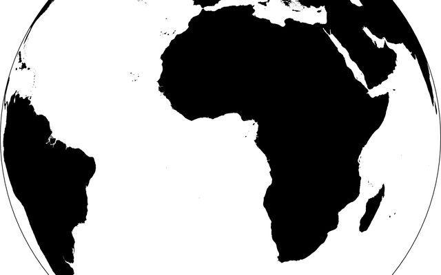
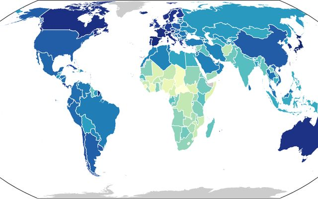
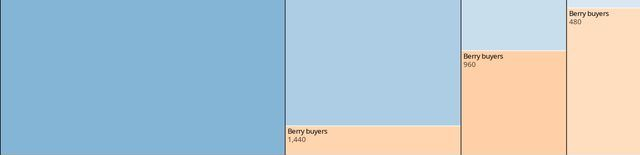
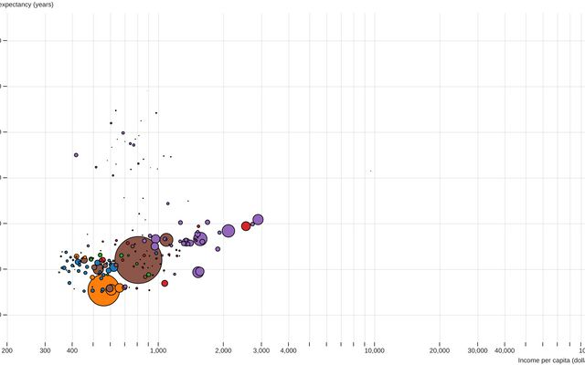
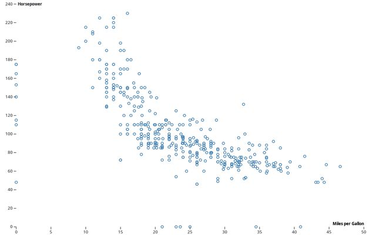
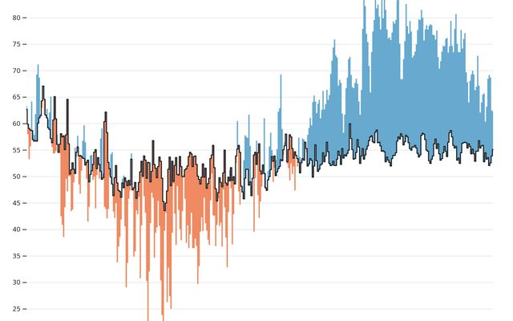
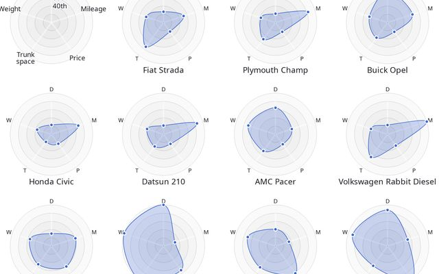
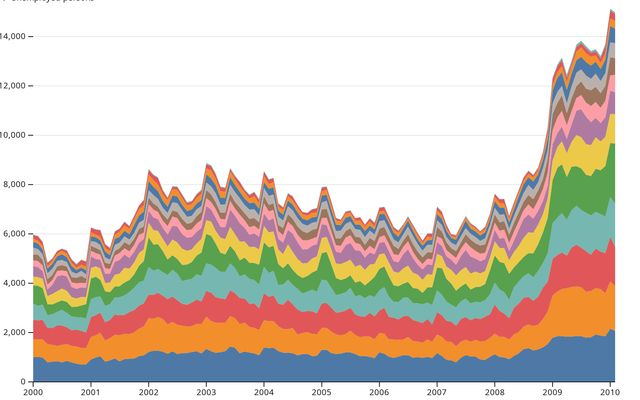
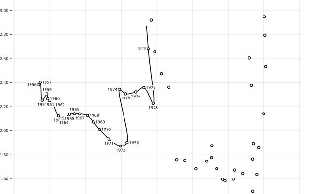

# 1st Iteration: Visualisation Technique Choices

> Brief: "Justified choice of the visualisation techniques selected (for representation,
> presentation, and interaction)."
>
> **Iteration-1 record.** After the feedback the five views became three; the current design is
> in [../iteration2/01-integration-plan.md](../iteration2/01-integration-plan.md).

Five linked views share the **year**, **year range**, **metric** and **country**. With no
country selected, Views 2 and 4 show the World. The design follows Shneiderman's mantra:

| Mantra step | Where |
|---|---|
| Overview | View 1 (globe), 2024, renewable share |
| Zoom / filter | Year slider and play, year range, metric modes, brush in View 3, legend filter in View 2 |
| Details on demand | Tooltips; Views 2 and 4 for the selected country |
| Relate | View 5 compares country profiles; brushing in View 3 highlights the globe |
| History | Play replays the years; Range average and Change summarise a period |

Each view shows a different slice of country × year × variable, so they do not repeat:

| View | Countries | Years | Variables | Question |
|---|---|---|---|---|
| 1 Map | all | 1, or a range (average or change) | 1 metric | *Where, and since when?* |
| 2 Marimekko | 1 | all | 9 sources + total | *What is the electricity made of?* |
| 3 Bubble scatter | all | 1 | 3 emissions measures | *Who pollutes most, by which measure?* |
| 4 Race + decomposition | 1 (or World) | range | generation, low-carbon, emissions | *Is green growth keeping up, and why?* |
| 5 Country profiles | a few | 1 | 6 indicators | *How do these countries compare?* |

## View 1: rotating globe

| Globe (orthographic) | Flat map (choropleth) |
|---|---|
|  |  |
| [*Versor dragging*](https://observablehq.com/@d3/versor-dragging) | [*World choropleth*](https://observablehq.com/@d3/world-choropleth) |

- **Answers:** where and when electricity got greener; which countries go against the trend.
- **Representation:** choropleth globe by renewable share (default), fossil share or carbon
  intensity, in three modes: **Year**; **Range average** (same sequential scale; a country needs
  data in half the years); **Change** between the first and last year (diverging scale centred
  on zero; needs both years). No data is grey.
- **Presentation:** largest view, legend, slider with play, coverage indicator. Scales fixed
  across years. The second slider handle sets the range (default from 2000) and View 4's start
  year. Diverging colours: green is greener or cleaner, red the opposite.
- **Interaction:** drag to rotate, hover for a tooltip, click to select (globe turns to it),
  search for small countries, **Globe / Flat map** toggle (Equal Earth, animated).
- **Why:** a map is the natural overview, and a globe is more engaging than OWID's flat map;
  rotation, search and the flat map make up for seeing half the world. Equal Earth keeps areas
  proportional. Range average smooths single odd years (a dry year cuts hydro). Change finds
  the countries against the trend: red areas on a green map.

## View 2: electricity mix over time (temporal Marimekko)

*Base: [Marimekko chart](https://observablehq.com/@d3/marimekko-chart), used over time.*

- **Answers:** what a country's electricity is made of, how it changed, how much generation grew.
- **Representation:** one column per year; **width** = total generation (TWh), segment
  **height** = source share (%), so segment **area** = TWh of that source. Fossil at the bottom
  (warm colours), then nuclear, renewables on top (cool colours).
- **Presentation:** selected year outlined; year labels under the columns (the x axis is not
  linear in time); dashed line at 50% low-carbon; the map's range shown as a band, other
  columns faded.
- **Interaction:** hover a segment for source, TWh and %; click a column to set the year;
  click a legend item to highlight a source.
- **Why:** a stacked area needs a TWh / % toggle; the Marimekko shows shares and growth at
  once. Widening columns with a slow-growing green part show the paradox. Widths are read less
  precisely, so the tests check it; the stacked area is the fallback.

## View 3: emissions bubble scatter

| Bubble scatter | Brushing |
|---|---|
|  |  |
| [*The Wealth & Health of Nations*](https://observablehq.com/@mbostock/the-wealth-health-of-nations) | [*Brushable scatterplot*](https://observablehq.com/@d3/brushable-scatterplot) |

- **Answers:** who pollutes most, and by which measure.
- **Representation:** one bubble per country; x = emissions per person (log), y = carbon
  intensity, area = total emissions, colour = the globe's metric.
- **Presentation:** units on the axes; labels for the largest emitters and the selected
  country; dashed World lines; notice before 2000.
- **Interaction:** hover, click to select, brush a group (highlighted on the globe); bubbles
  move when the year changes.
- **Why:** a bar chart ranks by one measure; the scatter shows three, so it shows that rankings
  disagree (China emits most in total, not per person).

## View 4: is green growth keeping up? (difference chart + decomposition)

*Base: [Difference chart](https://observablehq.com/@d3/difference-chart); the decomposition is our own.*

- **Answers:** is green growth keeping up with demand, why emissions changed, and whether a
  country found in View 1 really goes against the trend.
- **Representation:** two panels on one time axis, from the range start (default 2000).
  1. **Race:** growth since the start year of total generation (*new demand*) and of nuclear
     + renewables (*new low-carbon*), in TWh. The area between them is green where clean
     generation grew more, red where not; the gap equals the change in fossil generation.
  2. **Decomposition:** emissions = generation × carbon intensity (holds in all 6,002 rows with
     the three values). The change is split into a **demand effect** (above zero) and a **mix
     effect** (below zero), with a net-change line. LMDI makes the effects add up exactly.
     World 2000 to 2024: demand +7.8 Gt, mix -1.2 Gt, net +6.5 GtCO₂e.
- **Presentation:** TWh and MtCO₂e, selected year as a vertical line; a switch to values
  relative to the start year draws the country over the World in grey; notice before 2000.
- **Interaction:** hover for a year's values, click to set the year, start year from the slider.
- **Why:** the question is whether one quantity keeps up with another, which a difference chart
  shows as a coloured gap. The World is red almost everywhere: low-carbon grew 7,300 TWh,
  demand 15,700 TWh, so fossil grew 8,400 TWh. The race shows *that* emissions rose; the
  decomposition shows *why*. A connected scatterplot was harder to read (Haroz et al., 2016)
  and did not explain the cause.

## View 5: country profiles (radar small multiples)

*Base: [Plot: Radar chart, small multiples](https://observablehq.com/@observablehq/plot-radar-chart-faceted).*

- **Answers:** how a country compares with others on several measures; which countries are
  clean for different reasons (nuclear vs renewables).
- **Representation:** one radar per country, six axes: renewable share, nuclear share,
  generation per person, generation growth, emissions per person, carbon intensity. Clean axes
  on top, so a top-heavy shape reads as clean. Shares 0-100%; other axes to the 95th percentile,
  values above clipped and marked.
- **Presentation:** World first, then the selected country, then up to five more; the World
  shape in grey behind each; axis labels on the first radar only; light fill.
- **Interaction:** hover a vertex for value and unit; click to select; "+ Compare" in the
  tooltips of Views 1 and 3, × to remove.
- **Why:** a radar turns many variables into one shape, and small multiples make shapes easy
  to compare. France (nuclear) and Denmark (wind) both have low carbon intensity, but different
  shapes. Known problems (area grows with the square, axis order matters) are reduced by a fixed
  order, few axes, light fill and exact values on hover.
- **Library:** the base uses Observable Plot; we build it in D3, and would ask the teachers
  before using Plot.

## Cross-view interaction

- **Year** (slider, play, click in Views 2 and 4) updates every view.
- **Range** sets the map modes and View 4's start, shown as a band in View 2.
- **Country** (click on map, bubble or radar, or search) is highlighted in Views 1, 3, 5 and
  shown in Views 2 and 4.
- **Brush** in View 3 highlights the globe; **hover** in View 1 or 3 highlights the other.

Inspired by InsightChaser (Liu et al., 2026), below.

## Alternatives considered

| Technique | For | Why replaced |
|---|---|---|
|  Stacked area chart | View 2 | Needs a TWh / % toggle; middle layers have no flat baseline. Fallback if the Marimekko fails the tests |
|  Connected scatterplot | View 4 | Hard to read (Haroz et al., 2016); shows that emissions and renewables move together, not why |

## Related work

No code was reused from these works.

- **[OWID Energy](https://ourworldindata.org/energy)**, our data source: the metrics (shares,
  per person, carbon intensity), the mix over time, the map with a time slider and the
  multi-country selection. OWID shows one chart at a time; our views are linked, add range and
  change modes, and split demand from mix (View 4).
- **[World Energy Trends](https://observablehq.com/@emile-f/project-world-energy-trends)**, a
  D3 student project on BP data, with a one-variable Equal Earth choropleth close to View 1. It
  shows absolute consumption in one year on a flat map with separate charts; we show generation
  and emissions as shares, intensity and per-person values, over a range, in linked views.
- **InsightChaser** (Z. Liu, W. Zhao, X. Xie, A. Cao, Y. Wu, H. Zhang and Y. Wu, *IEEE TVCG*
  32(1), 2026, DOI 10.1109/TVCG.2025.3634639), studied in the course: it links a text insight to
  the matching elements of several views. We link views to each other through the shared year,
  range, metric and country, with no text or LLM.
- **D3 gallery and Observable examples:** the images above are their thumbnails
  (`img/examples/`), shown only to illustrate each technique.
